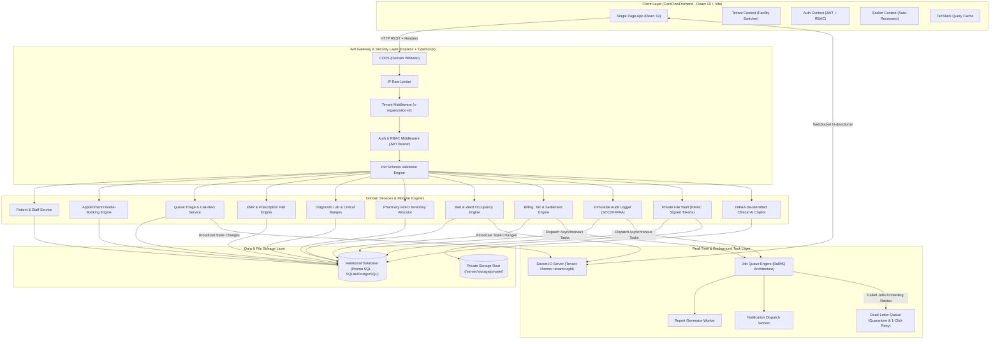

# CareFlow — System Architecture & Technical Design

## 1. Executive Summary

**CareFlow** is a modern, full-stack hospital operations and clinical EMR platform built with TypeScript, React 19, Express, Prisma ORM, and SQLite/PostgreSQL. The system is designed around multi-tenancy, HIPAA §164.312 security controls, real-time clinical event broadcasting, asynchronous queue processing with dead-letter quarantining, and private cryptographic document storage.

---

## 2. High-Level Architecture Diagram

---

## 3. Core Architectural Subsystems

### 3.1 Multi-Tenancy & Partition Boundary
CareFlow implements **logical data partitioning** through foreign key relationships to an `Organization` model:
- **Tenant Context Resolution**: Client requests transmit the facility identifier via `x-organization-id` headers (with automatic fallback to JWT payload claims and system default).
- **Middleware Injection**: `tenantMiddleware.ts` parses and attaches `req.organizationId` to Express requests.
- **Query Scoping**: Prisma queries enforce partition filters (`where: { organizationId }` or relational sub-filters such as `patient: { organizationId }`).
- **Zero Cross-Bleed**: Hospital Central records (`CF-CENTRAL`) cannot be viewed or modified by staff from West Metro Pavilion (`CF-WEST`), verified through automated integration test suites.

### 3.2 Real-Time Event Bus (`Socket.IO`)
The real-time layer operates over a clustered event bus with tenant-scoped room isolation:
- **Room Topology**: `tenant:${organizationId}` isolates broadcast traffic between physical facilities.
- **Queue Events**:
  - `queue:token_called`: Triggers visual status transitions on reception boards and plays an electronic hospital tone via client-side Web Audio API synthesizer.
  - `queue:token_created` & `queue:token_completed`: Synchronizes wait counts live.
- **Inpatient Bed Events**:
  - `bed:admitted`, `bed:transferred`, `bed:discharged`, and `bed:status_changed` notify nursing stations instantly of ward occupancy shifts.
- **Resilient Reconnection**: `SocketContext.tsx` handles transport drops with exponential backoff and triggers TanStack Query cache invalidations (`queryClient.invalidateQueries()`) upon reconnection.

### 3.3 Asynchronous Job Queue & Dead-Letter Isolation (BullMQ)
Long-running and failure-prone operations run out-of-band:
- **Task Workers**: Dedicated asynchronous workers process complex CSV report generation and staff push notifications without blocking Express request-response loops.
- **Retry Strategy**: Failed tasks undergo exponential backoff retries with deterministic delays.
- **Dead-Letter Queue (DLQ)**: Tasks failing all retry attempts are quarantined in the DLQ with full stack traces, input payloads, and timestamp telemetry, allowing 1-click administrative retries.

### 3.4 HIPAA §164.312(b) Private File Vault & Cryptographic Tokens
- **Private Storage Isolation**: File binaries reside at `server/storage/private/` outside of public web server roots.
- **HMAC Signed Download URLs**: Rather than static URLs, downloads require short-lived (15 minutes) cryptographically signed JWT tokens (`/api/v1/files/:id/signed-url`).
- **Binary Integrity**: SHA-256 hashes are calculated on upload and stored in `MedicalFile.checksum` to detect bitrot or tampering.
- **Immutable Download Auditing**: Every file streamed via `/api/v1/files/download/:token` increments audited download counts and appends an immutable compliance entry to `AuditLog`.

### 3.5 Clinical AI Copilot with HIPAA De-Identification Engine
- **Minimum-Data Principle**: A multi-stage regex engine scrubs Protected Health Information (PHI) including patient names, telephone numbers, emails, MRNs, and residential street addresses prior to processing.
- **Structured SOAP Extraction**: Synthesizes unstructured intake notes into executive clinical narratives, pertinent findings, and care plan recommendations.
- **Diagnostic Tagging**: Suggests standardized ICD-10 diagnostic tags (e.g. `I21.4`, `E11.65`, `J18.9`).
- **Human-in-the-Loop Safeguard**: Every AI-generated output is branded with a mandatory medical disclaimer banner, classified as `PENDING_PHYSICIAN_VERIFICATION`, and requires explicit clinician review before insertion into official medical charts.
- **Live Database Telemetry**: The Operational Assistant performs deterministic queries against live database models (beds, formulary items, appointment queues, invoices) to produce grounded, hallucination-free administrative answers.

---

## 4. Security & Compliance Architecture

| Area | Control Implementation | Standard / Regulation |
|------|------------------------|-----------------------|
| Authentication | Dual-token JWT (15-min access + 7-day refresh) with bcrypt password hashing (10 rounds) | NIST SP 800-63B |
| Access Control | Role-Based Access Control (Admin, Hospital Admin, Doctor, Nurse, Pharmacist, LabTech, Receptionist) | HIPAA §164.312(a)(1) |
| Multi-Tenancy | Header-driven partition filtering with zero cross-tenant query bleeding | SOC 2 Common Criteria |
| Audit Logging | Append-only database ledger tracking User, Action, Entity, IP, User-Agent, and Changed Delta | HIPAA §164.312(b) |
| File Storage | SHA-256 integrity validation, HMAC 15-minute signed streaming tokens, 10MB quota | HIPAA §164.312(c)(1) |
| Clinical AI | Server-side regex PHI redaction, explicit human-in-the-loop review, medical disclaimer | HIPAA §164.514 |
