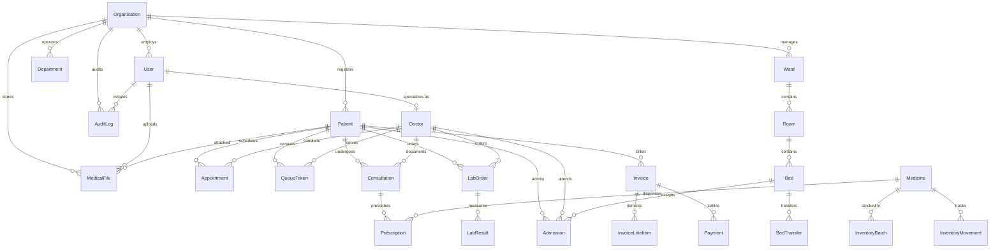

# CareFlow — Database Schema & Entity Documentation

## 1. Overview
The CareFlow database architecture is defined through Prisma ORM targeting SQLite for local rapid iteration and zero-dependency deployments, fully compatible with PostgreSQL for production.

---

## 2. Entity Relationship Overview

---

## 3. Data Dictionary

### 3.1 Organization & Security
- **`Organization`**: Multi-tenant facility boundary (`id`, `name`, `code`, `address`, `phone`, `email`, `createdAt`, `updatedAt`).
- **`User`**: Hospital staff directory (`id`, `email`, `passwordHash`, `name`, `role`, `status`, `organizationId`, `createdAt`, `updatedAt`).
  - Roles: `Admin`, `Hospital Admin`, `Doctor`, `Nurse`, `Pharmacist`, `LabTech`, `Receptionist`, `Patient`.
- **`AuditLog`**: Append-only security audit ledger (`id`, `userId`, `action`, `entityType`, `entityId`, `details`, `ipAddress`, `userAgent`, `organizationId`, `createdAt`).

### 3.2 Patient & Clinical Staff
- **`Patient`**: Patient demographic chart (`id`, `mrn`, `name`, `age`, `gender`, `bloodGroup`, `phone`, `email`, `address`, `emergencyName`, `emergencyPhone`, `emergencyRelation`, `allergies`, `status`, `organizationId`, `createdAt`, `updatedAt`).
- **`Doctor`**: Clinical credentials and schedule rota (`id`, `name`, `email`, `specialty`, `qualification`, `room`, `experienceYears`, `phone`, `status`, `organizationId`, `userId`, `createdAt`, `updatedAt`).
- **`Department`**: Clinical departments (`id`, `name`, `code`, `description`, `headOfDept`, `status`, `organizationId`).

### 3.3 Outpatient Workflow (Appointments & Queue)
- **`Appointment`**: Scheduled visit slots (`id`, `patientId`, `doctorId`, `departmentId`, `date`, `time`, `type`, `status`, `notes`, `createdAt`, `updatedAt`).
  - Statuses: `Scheduled`, `Confirmed`, `Completed`, `Cancelled`, `No Show`.
- **`QueueToken`**: Walk-in & appointment arrival tokens (`id`, `tokenNumber`, `patientId`, `doctorId`, `departmentId`, `status`, `priority`, `calledAt`, `completedAt`, `createdAt`, `updatedAt`).
  - Priorities: `Normal`, `Urgent`, `Emergency`.
  - Statuses: `Waiting`, `Called`, `In-Consultation`, `Completed`, `Skipped`, `Cancelled`.

### 3.4 Encounters & Diagnostic Pathology
- **`Consultation`**: Clinical visit notes (`id`, `patientId`, `doctorId`, `appointmentId`, `queueTokenId`, `chiefComplaint`, `diagnosis`, `clinicalNotes`, `status`, `vitalsBp`, `vitalsPulse`, `vitalsTemp`, `vitalsSpo2`, `vitalsWeight`, `createdAt`, `updatedAt`).
- **`Prescription`**: Medication regimens (`id`, `consultationId`, `patientId`, `doctorId`, `medicineId`, `medicationName`, `dosage`, `frequency`, `duration`, `instructions`, `status`, `dispensedAt`, `createdAt`, `updatedAt`).
- **`LabOrder`**: Diagnostic test requests (`id`, `orderNumber`, `patientId`, `doctorId`, `consultationId`, `testCategory`, `testName`, `priority`, `status`, `clinicalNotes`, `collectedAt`, `completedAt`, `createdAt`, `updatedAt`).
- **`LabResult`**: Itemized biochemical parameters (`id`, `labOrderId`, `parameterName`, `measuredValue`, `unit`, `referenceRange`, `status`, `technicianNotes`, `verifiedBy`, `createdAt`).
  - Result Statuses: `Normal`, `Abnormal`, `Critical`.

### 3.5 Pharmacy & Medication Inventory
- **`Medicine`**: Formulary master catalog (`id`, `sku`, `name`, `brandName`, `category`, `dosageForm`, `strength`, `unitPrice`, `costPrice`, `currentStock`, `minStockLevel`, `prescriptionRequired`, `manufacturer`, `storageConditions`, `createdAt`, `updatedAt`).
- **`InventoryBatch`**: Batch tracking with FEFO expiry (`id`, `medicineId`, `batchNumber`, `quantityReceived`, `quantityRemaining`, `expiryDate`, `purchaseDate`, `supplierName`, `costPerUnit`, `status`).
- **`InventoryMovement`**: Immutable stock movement audit ledger (`id`, `medicineId`, `batchId`, `movementType`, `quantity`, `remainingStockAfter`, `reference`, `notes`, `createdAt`).

### 3.6 Inpatient Beds & Wards
- **`Ward`**: Hospital ward division (`id`, `name`, `code`, `floor`, `genderAllowed`, `dailyRate`, `organizationId`).
- **`Room`**: Inpatient rooms (`id`, `roomNumber`, `wardId`, `roomType`).
- **`Bed`**: Individual beds with real-time status (`id`, `bedNumber`, `roomId`, `wardId`, `status`, `createdAt`, `updatedAt`).
  - Bed Statuses: `Available`, `Occupied`, `Reserved`, `Maintenance`, `Cleaning`.
- **`Admission`**: Inpatient stay lifecycle (`id`, `admissionNumber`, `patientId`, `bedId`, `doctorId`, `admitDate`, `dischargeDate`, `admissionType`, `admitDiagnosis`, `dischargeNotes`, `status`, `createdAt`, `updatedAt`).
- **`BedTransfer`**: Audit trail of bed movements (`id`, `admissionId`, `fromBedId`, `toBedId`, `reason`, `transferredBy`, `transferredAt`).

### 3.7 Financials, Billing & Receivables
- **`Invoice`**: Patient bills (`id`, `invoiceNumber`, `patientId`, `consultationId`, `admissionId`, `status`, `issueDate`, `dueDate`, `subtotal`, `discount`, `taxRate`, `taxAmount`, `totalAmount`, `paidAmount`, `balanceDue`, `notes`, `createdAt`, `updatedAt`).
  - Invoice Statuses: `Draft`, `Issued`, `Partially Paid`, `Paid`, `Cancelled`, `Refunded`.
- **`InvoiceLineItem`**: Itemized charges (`id`, `invoiceId`, `itemType`, `description`, `quantity`, `unitPrice`, `amount`).
- **`Payment`**: Transaction receipts (`id`, `receiptNumber`, `invoiceId`, `patientId`, `amount`, `paymentMethod`, `transactionRef`, `notes`, `cashierName`, `paidAt`).

### 3.8 Private Document Storage
- **`MedicalFile`**: HIPAA private document repository (`id`, `originalName`, `storageKey`, `mimeType`, `sizeBytes`, `category`, `checksum`, `downloadCount`, `patientId`, `consultationId`, `labOrderId`, `uploadedById`, `organizationId`, `description`, `createdAt`, `updatedAt`).
  - Categories: `Radiology`, `LabReport`, `DischargeSummary`, `Prescription`, `Insurance`, `Other`.
